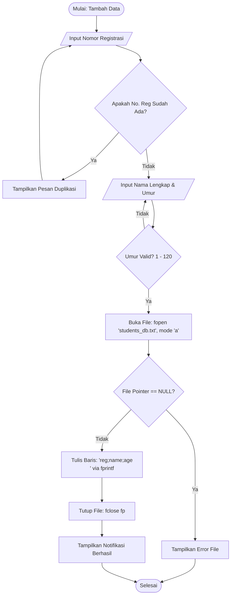
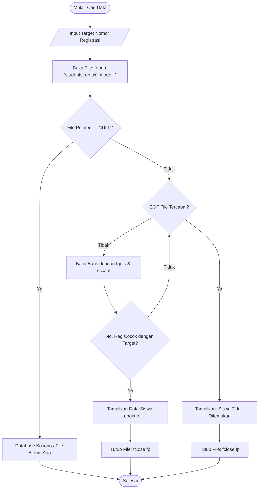
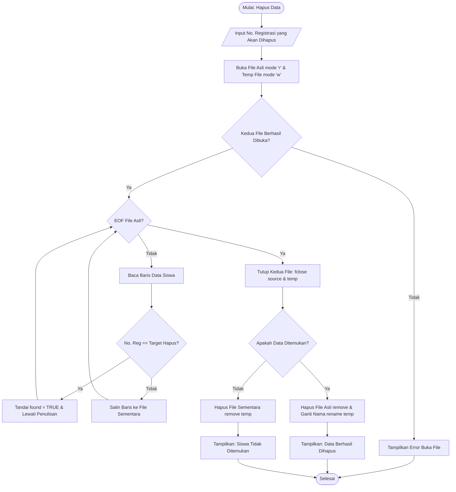
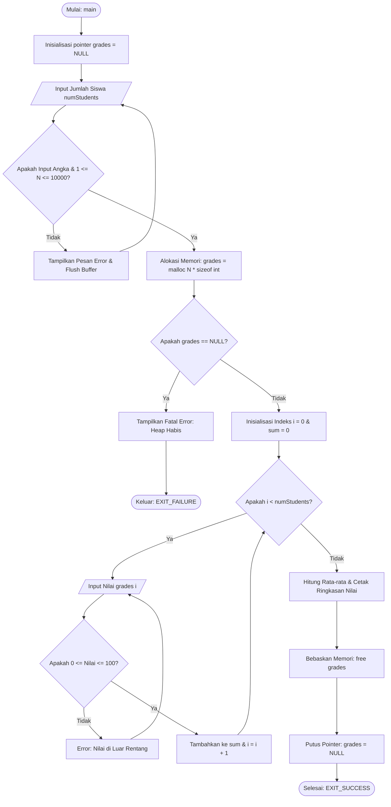

# 📝 LAPORAN RESMI JAWABAN TUGAS KELOMPOK KE-2 (TK2)
**Mata Kuliah:** Algorithm and Programming (COMP6112036)  
**Kelas:** DCCA - LEC  
**Dosen Pengampu:** D5816 - ERIC GUNAWAN, S.Kom., M.TI  
**Kelompok:** Group 1  
**Topik Pembelajaran:** File Handling (I/O) & Dynamic Memory Allocation  
**Minggu Kuliah:** Week 8 (Sesi 21 - R3)  

---

## 👥 Profil Kelompok & Kontribusi Pengerjaan
| No | Nama Mahasiswa | NIM | Peran Utama | Bagian Dikerjakan |
|:--:|:---|:---:|:---:|:---|
| 1 | Chandra Perdiansyah | 2802619424 | **Paket A (Role 1)** | Lead Reviewer, Flowchart System, Final Sign-off |
| 2 | *[Anggota 2]* | *[NIM 2]* | **Paket B (Role 2)** | Implementasi Kode C Tugas 1 (`question_1.c`) |
| 3 | *[Anggota 3]* | *[NIM 3]* | **Paket C (Role 3)** | Analisis RCA & Kode C Tugas 2 (`question_2_fixed.c`) |
| 4 | *[Anggota 4]* | *[NIM 4]* | **Paket D (Role 4)** | Analisis Format File & Efisiensi Pengelolaan Memori |
| 5 | *[Anggota 5]* | *[NIM 5]* | **Paket E (Role 5)** | Penyusunan Laporan, Diagram, & Sitasi Akademik |

---

# BAGIAN I: TUGAS 1 — ANALISIS KEBUTUHAN PROGRAM MANAJEMEN FILE (BOBOT 60%)

## 1.1 Latar Belakang & Deskripsi Kebutuhan
Divisi Algoritma dan Pemrograman Dasar di Lembaga Pelatihan Teknologi Nusantara membutuhkan modul simulasi manajemen database sederhana menggunakan file persisten. Modul ini digunakan untuk menyimpan, mengelola, dan memanipulasi data siswa secara aman dengan 3 operasi dasar:
1. **Menambah data siswa** (*Create/Append*)
2. **Mencari data siswa** (*Search by Registration Number*)
3. **Menghapus data siswa** (*Delete via safe temporary file filter*)

Setiap entri siswa dimodelkan dalam struktur bahasa C sebagai berikut:
```c
typedef struct {
    char reg_number[20]; // Nomor Registrasi Unik (Primary Key)
    char name[50];       // Nama Lengkap Siswa
    int age;             // Umur Siswa dalam Tahun
} Student;
```

---

## 1.2 Pseudocode Mendetail untuk 3 Operasi Utama

### 1.2.1 Pseudocode Operasi 1: Tambah Data Siswa (*Append Data*)
```text
ALGORITHM TambahDataSiswa
INPUT: reg_number (String), name (String), age (Integer)
OUTPUT: Status keberhasilan penyimpanan ke file database

BEGIN
    DISPLAY "--- Tambah Data Siswa Baru ---"
    
    // Validasi input nomor registrasi
    REPEAT
        PROMPT "Masukkan Nomor Registrasi: "
        READ reg_number
        IF StudentExists(reg_number) THEN
            DISPLAY "Peringatan: Nomor Registrasi sudah terdaftar! Gunakan nomor lain."
        ENDIF
    UNTIL NOT StudentExists(reg_number)

    PROMPT "Masukkan Nama Lengkap: "
    READ name

    REPEAT
        PROMPT "Masukkan Umur (1 - 120): "
        READ age
    UNTIL age > 0 AND age <= 120

    // Buka file dengan mode append ("a") agar data lama tidak tertimpa
    file_pointer = OPEN("students_db.txt", MODE_APPEND)
    
    IF file_pointer IS NULL THEN
        DISPLAY "Kesalahan: Gagal membuka file database!"
        RETURN ERROR
    ENDIF

    // Tulis entri dengan format delimited (REG;NAME;AGE)
    WRITE_LINE file_pointer, reg_number + ";" + name + ";" + TO_STRING(age)

    // Tutup file stream untuk memastikan data ter-flush ke storage fisik
    CLOSE file_pointer
    
    DISPLAY "Data siswa berhasil disimpan secara persisten."
END
```

---

### 1.2.2 Pseudocode Operasi 2: Cari Data Siswa (*Search by Registration Number*)
```text
ALGORITHM CariDataSiswa
INPUT: target_reg (String)
OUTPUT: Detail informasi siswa jika ditemukan, atau pesan tidak ditemukan

BEGIN
    DISPLAY "--- Cari Data Siswa ---"
    PROMPT "Masukkan Nomor Registrasi yang dicari: "
    READ target_reg

    file_pointer = OPEN("students_db.txt", MODE_READ)
    
    IF file_pointer IS NULL THEN
        DISPLAY "Database masih kosong atau file belum dibuat."
        RETURN
    ENDIF

    found = FALSE
    
    // Sequential Scan baris demi baris (Line-by-line streaming)
    WHILE NOT END_OF_FILE(file_pointer) DO
        line = READ_LINE(file_pointer)
        PARSE line INTO curr_reg, curr_name, curr_age WITH DELIMITER ";"
        
        IF curr_reg EQUALS target_reg THEN
            DISPLAY "=== DATA SISWA DITEMUKAN ==="
            DISPLAY "Nomor Registrasi : " + curr_reg
            DISPLAY "Nama Lengkap     : " + curr_name
            DISPLAY "Umur             : " + TO_STRING(curr_age) + " tahun"
            found = TRUE
            BREAK // Hentikan pencarian karena nomor registrasi unik
        ENDIF
    ENDWHILE

    IF found IS FALSE THEN
        DISPLAY "Siswa dengan Nomor Registrasi " + target_reg + " tidak ditemukan."
    ENDIF

    CLOSE file_pointer
END
```

---

### 1.2.3 Pseudocode Operasi 3: Hapus Data Siswa (*Safe Temporary File Rewrite*)
```text
ALGORITHM HapusDataSiswa
INPUT: target_reg (String)
OUTPUT: Status penghapusan data siswa dari file database

BEGIN
    DISPLAY "--- Hapus Data Siswa ---"
    PROMPT "Masukkan Nomor Registrasi siswa yang akan dihapus: "
    READ target_reg

    source_file = OPEN("students_db.txt", MODE_READ)
    IF source_file IS NULL THEN
        DISPLAY "Database kosong. Tidak ada data yang dapat dihapus."
        RETURN
    ENDIF

    temp_file = OPEN("temp_students_db.txt", MODE_WRITE)
    IF temp_file IS NULL THEN
        DISPLAY "Kesalahan internal: Gagal membuat file sementara."
        CLOSE source_file
        RETURN ERROR
    ENDIF

    found = FALSE

    WHILE NOT END_OF_FILE(source_file) DO
        line = READ_LINE(source_file)
        PARSE line INTO curr_reg, curr_name, curr_age WITH DELIMITER ";"

        IF curr_reg EQUALS target_reg THEN
            found = TRUE
            // Lewati baris ini (jangan disalin ke temp_file)
        ELSE
            WRITE_LINE temp_file, line
        ENDIF
    ENDWHILE

    CLOSE source_file
    CLOSE temp_file

    IF found IS TRUE THEN
        DELETE_FILE("students_db.txt")
        RENAME_FILE("temp_students_db.txt", "students_db.txt")
        DISPLAY "Data siswa dengan Nomor Registrasi " + target_reg + " berhasil dihapus."
    ELSE
        DELETE_FILE("temp_students_db.txt")
        DISPLAY "Data siswa tidak ditemukan. Tidak ada perubahan yang dilakukan."
    ENDIF
END
```

---

## 1.3 Flowchart Logika Operasi (Diagram Alir Sistem)

### 1.3.1 Flowchart Operasi Tambah Data Siswa


---

### 1.3.2 Flowchart Operasi Cari Data Siswa


---

### 1.3.3 Flowchart Operasi Hapus Data Siswa (Metode Temporary File)


---

## 1.4 Deskripsi & Desain Format File yang Dipakai

### 1.4.1 Perbandingan Teknis: File Teks Terstruktur (CSV) vs File Biner (`.dat`)
Dalam perancangan modul database Lembaga Pelatihan Teknologi Nusantara, tim mengevaluasi dua opsi format penyimpanan:

| Parameter Evaluasi | Format File Teks Delimited (`.txt` / `.csv`) | Format File Biner (`.dat` / `fwrite`) | Pilihan Desain Terpilih |
| :--- | :--- | :--- | :---: |
| **Human Readability** | Sangat tinggi; dapat diinspeksi langsung menggunakan text editor (Notepad, VS Code) | Rendah; hanya dapat dibaca melalui hexdump atau program khusus | **File Teks Delimited** |
| **Portabilitas Antar-Platform** | Tinggi; format teks ANSI/UTF-8 tidak terpengaruh perbedaan arsitektur CPU | Rentan; terikat pada *structure padding*, *endianness* (Big/Little Endian), dan ukuran word CPU | **File Teks Delimited** |
| **Kemudahan Debugging** | Mudah melacak korupsi data per baris | Sulit memverifikasi batas record jika korup | **File Teks Delimited** |
| **Efisiensi Ruang Disk** | Sedikit lebih besar untuk angka (misal angka "100" butuh 3 byte teks vs 4 byte int) | Ukuran fixed record strictly terhitung | File Biner |
| **Kecepatan Akses Acak** | Membutuhkan parsing baris sekuensial | Mendukung `fseek()` fixed size record | File Biner |

### 1.4.2 Format Spesifikasi yang Dipilih
Sesuai dengan target simulasi pelatihan siswa, format yang dipilih adalah **File Teks Terstruktur (Separated by Semicolon `;`)**:
* **Ekstensi File:** `students_db.txt`
* **Pemisah Kolom (*Delimiter*):** Karakter titik-koma (`;`). Alasan memilih `;` daripada koma (`,`) adalah karena nama siswa terkadang memiliki gelar atau tanda koma (misal: "Budi, S.Kom"), sehingga `;` jauh lebih aman dari konflik parsing.
* **Karakter Akhir Baris (*End of Line*):** Karakter newline (`\n` pada Unix/Linux atau `\r\n` pada Windows).
* **Format Entri Baris:**
  $$\text{NOMOR\_REGISTRASI}\; ; \; \text{NAMA\_LENGKAP}\; ; \; \text{UMUR}$$
* **Contoh Data Fisik pada File:**
  ```text
  REG001;Chandra Perdiansyah;20
  REG002;Budi Santoso;22
  REG003;Siti Nurhaliza;19
  ```

---

## 1.5 Analisis Pengelolaan Memori Program (Read & Write)

### 1.5.1 Mekanisme Buffer I/O pada Standard C Library
Ketika program memanggil `fopen()`, fungsi runtime C secara otomatis mengalokasikan **I/O Stream Buffer** sebesar konstanta `BUFSIZ` (biasanya 512 byte hingga 4096 byte) di memori internal:
* **Pada Operasi Penulisan (*Write/Append*):** Pemanggilan `fprintf()` tidak langsung menulis byte demi byte ke hard drive fisik. Sebaliknya, data disimpan terlebih dahulu ke dalam *write buffer*. Saat pemanggilan `fclose(fp)` dieksekusi, sistem secara otomatis melakukan *buffer flushing* ke disk fisik. Hal ini mengurangi *I/O system call overhead* secara drastis.
* **Pada Operasi Pembacaan (*Read/Search*):** Pemanggilan `fgets()` membaca blok data dari disk ke *read buffer*, lalu mengalirkan string per baris ke buffer lokal di memori program.

### 1.5.2 Komparasi Arsitektur Memori: Streaming Buffer vs Full Dynamic Array Load
Sistem ini secara sengaja dirancang menggunakan pendekatan **Line-by-Line Streaming Buffer** daripada meload seluruh database ke heap array:

| Aspek Memori | Pola A: In-Memory Dynamic Array (Load All) | Pola B: Line-by-Line Streaming (Implementasi Tim) |
| :--- | :--- | :--- |
| **Kompleksitas Ruang (*Space Complexity*)** | $\mathbf{O(N)}$ — Memori RAM bertambah linear seiring bertambahnya jumlah siswa | $\mathbf{O(1)}$ — Memori RAM konstan terlepas dari seberapa besar file |
| **Konsumsi RAM untuk 10.000 Siswa** | $\approx 10.000 \times 74\text{ byte} \approx \mathbf{740\text{ KB}}$ di Heap | Hanya $\mathbf{256\text{ byte}}$ di Stack (`char line[256]`) |
| **Konsumsi RAM untuk 1.000.000 Siswa** | $\approx \mathbf{74\text{ MB}}$ RAM di Heap | Tetap konstan $\mathbf{256\text{ byte}}$ di Stack |
| **Risiko Kehabisan Memori (*OOM*)** | Sangat berisiko crash jika file database berukuran gigabyte | **0% risiko OOM**, sangat aman untuk server dengan RAM terbatas |
| **Manajemen Memori** | Memerlukan alokasi dinamis `malloc()` dan `free()` bertingkat | Bersih, dialokasikan otomatis di stack frame dan dibersihkan saat fungsi return |

Dengan arsitektur ini, program memiliki integritas performa tinggi, jejak memori (*memory footprint*) yang sangat kecil ($\le 1\text{ KB}$), dan tidak memiliki risiko kebocoran memori (*memory leak*).

---

# BAGIAN II: TUGAS 2 — ANALISIS KESALAHAN ALOKASI MEMORI (BOBOT 40%)

## 2.1 Analisis & Root Cause Analysis (RCA) Kode Bermasalah
Potongan kode asli yang diberikan pada soal:
```c
#include <stdio.h>
#include <stdlib.h>
int main() {
    int *grades;
    int numStudents, i;
    printf("Enter number of students: ");
    scanf("%d", &numStudents);
    grades = malloc(numStudents * sizeof(int));  // Memory allocation
    for(i = 0; i < numStudents; i++) {
        printf("Enter grade for student %d: ", i + 1);
        scanf("%d", &grades[i]);
    }
    // Memory leak, no free call
    return 0;
}
```

Berdasarkan tinjauan keamanan perangkat lunak (*software security auditing*), terdapat **5 kelemahan fatal** pada kode tersebut:

### 1. 🛑 Kesalahan Fatal: Critical Memory Leak (Tanpa Pemanggilan `free()`)
* **Masalah:** Fungsi `malloc(numStudents * sizeof(int))` memesan sejumlah blok memori di area Heap. Namun, kode langsung mengeksekusi `return 0` tanpa pernah memanggil `free(grades)`.
* **Dampak:** Blok memori tersebut berstatus "terpakai" (*allocated/orphaned*) hingga proses berakhir. Jika pola ini diterapkan pada fungsi di dalam loop aplikasi server atau sistem akademik yang berjalan terus-menerus, memori RAM akan bocor secara progresif (*memory leak*) hingga sistem mengalami kondisi *Out of Memory* (OOM) dan OS terpaksa melakukan terminasi paksa (*crash*).

### 2. ⚠️ Potensi Segmentation Fault: Unchecked Pointer Allocation (Ketiadaan Validasi `NULL`)
* **Masalah:** Fungsi `malloc()` tidak dijamin selalu berhasil. Jika sistem kekurangan memori fisik, kuota memori proses terlampaui, atau terjadi fragmentasi heap, `malloc()` akan mengembalikan pointer bernilai `NULL`.
* **Dampak:** Pada kode asli, pointer `grades` langsung diakses di dalam loop `grades[i] = ...` tanpa pengecekan. Mengakses pointer `NULL` (*Null Pointer Dereference*) akan langsung memicu sinyal `SIGSEGV` (*Segmentation Fault*), menyebabkan program mengalami *instant termination* (*crash*).

### 3. ⚠️ Ketiadaan Validasi Nilai Input `numStudents` (Risiko Integer Overflow)
* **Masalah:** Nilai `numStudents` diterima langsung dari pengguna tanpa validasi:
  - Jika pengguna memasukkan angka negatif (misal `-5`), parameter perkalian `numStudents * sizeof(int)` yang bertipe `size_t` (*unsigned*) akan mengalami *implicit cast* menjadi bilangan unsigned raksasa, menyebabkan alokasi memori gagal.
  - Jika pengguna memasukkan angka 0, `malloc(0)` mengembalikan implementasi yang bergantung pada platform (pointer unik yang tidak dapat diakses atau `NULL`), sehingga perulangan berikutnya berpotensi memicu perilaku tidak terdefinisi (*undefined behavior*).
  - Jika pengguna menginput angka raksasa (misal $2^{30}$), operasi perkalian `numStudents * sizeof(int)` dapat mengalami *arithmetic integer overflow*, membungkus nilai menjadi kecil dan mengakibatkan *heap-based buffer overflow*.

### 4. ⚠️ Kerapuhan Aliran Input: Unchecked Return Value dari `scanf()`
* **Masalah:** Pemanggilan `scanf("%d", &numStudents)` tidak memeriksa nilai kembaliannya.
* **Dampak:** Jika pengguna secara tidak sengaja menginput huruf (misal: "sepuluh"), `scanf` akan gagal membaca, mengembalikan nilai 0, dan karakter tersebut tertinggal di *standard input buffer*. Variabel `numStudents` akan tetap berisi nilai sampah (*garbage value*), yang menyebabkan program melakukan alokasi dan perulangan secara tak menentu.

### 5. ⚠️ Risiko Dangling Pointer
* **Masalah:** Meskipun nantinya ditambahkan `free(grades)`, pointer `grades` masih menyimpan alamat lama yang sudah tidak valid jika tidak disetel ke `NULL`.
* **Dampak:** Jika ada pengembangan kode lebih lanjut, pointer yang tidak di-nullifikasi rentan memicu bug *Use-After-Free* atau *Double Free*.

---

## 2.2 Kode C Perbaikan (Clean, Robust, & Safe Implementation)
Berikut adalah kode program C yang telah diperbaiki secara menyeluruh sesuai dengan *best practice* ISO C dan standar perkuliahan Binus University (tersedia juga di berkas [`question_2_fixed.c`](question_2_fixed.c)):

```c
/**
 * ============================================================================
 * Program      : question_2_fixed.c (SOLUSI PERBAIKAN TUGAS 2)
 * Deskripsi    : Program Pencatatan Nilai Siswa Menggunakan Alokasi Memori Dinamis
 *                yang Aman dari Memory Leak dan Null Pointer Dereference.
 * ============================================================================
 */

#include <stdio.h>
#include <stdlib.h>

#define MAX_STUDENTS 10000 // Batasan kapasitas maksimum logis

// Fungsi untuk membersihkan sisa karakter di buffer keyboard
void flush_input_buffer() {
    int c;
    while ((c = getchar()) != '\n' && c != EOF);
}

int main() {
    int *grades = NULL;
    int numStudents = 0;
    int i;
    int sum = 0;
    double average = 0.0;

    printf("====================================================\n");
    printf("   PROGRAM PENCATATAN NILAI SISWA (ALOKASI DINAMIS) \n");
    printf("====================================================\n");

    // 1. Validasi Input Jumlah Siswa (Pencegahan Input Salah & Negatif)
    while (1) {
        printf("Masukkan jumlah siswa (1 - %d): ", MAX_STUDENTS);
        if (scanf("%d", &numStudents) != 1) {
            printf("[!] Error: Input harus berupa bilangan bulat positif!\n");
            flush_input_buffer();
            continue;
        }
        flush_input_buffer();

        if (numStudents <= 0) {
            printf("[!] Error: Jumlah siswa harus lebih besar dari 0!\n");
            continue;
        }

        if (numStudents > MAX_STUDENTS) {
            printf("[!] Error: Jumlah siswa melebihi batas maksimal (%d)!\n", MAX_STUDENTS);
            continue;
        }

        break; // Input valid
    }

    // 2. Alokasi Memori Dinamis di Heap
    grades = (int *)malloc(numStudents * sizeof(int));

    // 3. Pengecekan Keberhasilan Alokasi Memori (NULL Check)
    if (grades == NULL) {
        fprintf(stderr, "\n[FATAL ERROR] Alokasi memori sebesar %zu byte gagal!\n",
                (size_t)numStudents * sizeof(int));
        fprintf(stderr, "              Sistem kehabisan memori (RAM).\n");
        return EXIT_FAILURE;
    }

    printf("[✓] Sukses mengalokasikan %zu byte memori di Heap.\n\n",
           (size_t)numStudents * sizeof(int));

    // 4. Input Nilai Siswa dengan Validasi Rentang (0 - 100)
    for (i = 0; i < numStudents; i++) {
        while (1) {
            printf("Masukkan nilai untuk siswa ke-%d (0 - 100): ", i + 1);
            if (scanf("%d", &grades[i]) != 1) {
                printf("[!] Error: Nilai harus berupa angka bulat!\n");
                flush_input_buffer();
                continue;
            }
            flush_input_buffer();

            if (grades[i] < 0 || grades[i] > 100) {
                printf("[!] Error: Rentang nilai akademik valid adalah 0 hingga 100!\n");
                continue;
            }

            break; // Nilai siswa valid
        }
        sum += grades[i];
    }

    // 5. Pengolahan Data & Penampilan Statistik
    average = (double)sum / numStudents;
    printf("\n----------------------------------------------------\n");
    printf("RINGKASAN DATA NILAI SISWA:\n");
    printf("----------------------------------------------------\n");
    for (i = 0; i < numStudents; i++) {
        printf("Siswa ke-%-3d : %d\n", i + 1, grades[i]);
    }
    printf("----------------------------------------------------\n");
    printf("Total Siswa   : %d orang\n", numStudents);
    printf("Nilai Rata-rata: %.2f\n", average);
    printf("----------------------------------------------------\n");

    // 6. Pembebasan Memori Dinamis (Mencegah Memory Leak)
    free(grades);

    // 7. Nullifikasi Pointer (Mencegah Dangling Pointer)
    grades = NULL;

    printf("\n[✓] Memori Heap berhasil dibebaskan (free) dan pointer di-set ke NULL.\n");
    printf("[✓] Program selesai dengan aman tanpa memory leak.\n");

    return EXIT_SUCCESS;
}
```

---

## 2.3 Flowchart Proses Alokasi Memori yang Benar
Diagram alir proses di bawah ini menggambarkan arsitektur eksekusi program perbaikan yang mengeliminasi seluruh potensi memory leak dan crash:



---

# BAGIAN III: DAFTAR REFERENSI & SITASI AKADEMIK

Sesuai dengan ketentuan akademik Universitas Bina Nusantara, berikut adalah sumber referensi yang digunakan dalam penyusunan tugas:

1. **Bina Nusantara University**, "Lecture Notes LN07: Structures and Union," *Algorithm and Programming Course Material*, Jakarta: Bina Nusantara University, 2026.
2. **Bina Nusantara University**, "Lecture Notes LN08: Memory Allocation and File Processing," *Algorithm and Programming Course Material*, Jakarta: Bina Nusantara University, 2026.
3. **ISO/IEC**, "ISO/IEC 9899:2018 (C18 Standard) - Information technology — Programming languages — C," *International Organization for Standardization*, Geneva, Switzerland, 2018.
4. **Kernighan, B. W., & Ritchie, D. M.**, *The C Programming Language*, 2nd ed., Englewood Cliffs, NJ: Prentice Hall, 1988, pp. 165–189.
5. **Seacord, R. C.**, *Secure Coding in C and C++*, 2nd ed., Upper Saddle River, NJ: Addison-Wesley Professional, 2013 (Bab 4: Dynamic Memory Management, Bab 5: Unintentional Memory Corruption).
6. **Cppreference.com**, "C Dynamic memory management: malloc, free," https://en.cppreference.com/w/c/memory, diakses pada 15 Oktober 2026.
7. **Cppreference.com**, "C File input/output: fopen, fclose, fgets, fprintf," https://en.cppreference.com/w/c/io, diakses pada 15 Oktober 2026.
