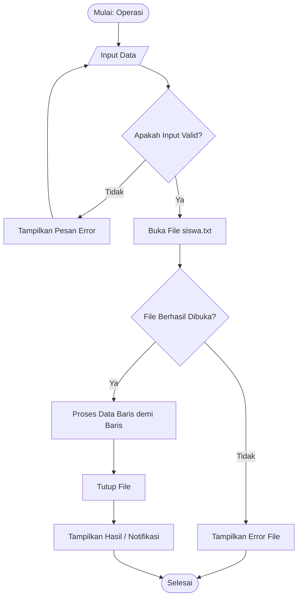

# 📝 TEMPLATE PENGERJAAN OPERASI (TUGAS 1)
**Nama Anggota:** [Nama Lengkap Anda]  
**NIM:** [Nomor Induk Mahasiswa]  
**Operasi yang Dikerjakan:** [Pilih salah satu: Tambah Data Siswa / Cari Data Siswa / Hapus Data Siswa]  

---

## 1. Deskripsi Alur Operasi
*Jelaskan secara singkat logika operasi yang Anda rancang (2–4 kalimat).*
*Contoh:*
> Operasi ini menerima masukan dari pengguna berupa... kemudian memeriksa apakah data valid... selanjutnya membuka file `siswa.txt` dengan mode... dan menuliskan/mencari data sesuai format...

---

## 2. Pseudocode
*Tuliskan pseudocode Anda di bawah ini dengan menggunakan huruf kapital untuk kata kunci (`BEGIN`, `END`, `IF`, `THEN`, `ELSE`, `WHILE`, `DO`, `OPEN`, `CLOSE`).*

```text
ALGORITHM [NamaOperasi]
INPUT: ...
OUTPUT: ...

BEGIN
    // 1. Tampilkan judul operasi
    DISPLAY "--- ... ---"

    // 2. Input dan validasi data
    ...

    // 3. Operasi file
    file_pointer = OPEN("siswa.txt", MODE_...)
    IF file_pointer IS NULL THEN
        DISPLAY "Pesan error..."
        RETURN
    ENDIF

    // 4. Proses membaca/menulis data
    ...

    // 5. Tutup file
    CLOSE file_pointer
    
    DISPLAY "Pesan sukses..."
END
```

---

## 3. Flowchart
*Anda dapat menyertakan diagram alir menggunakan format diagram Mermaid di bawah ini, ATAU menyisipkan gambar flowchart (`.png` / `.jpg`) yang dibuat dari draw.io.*



*(Catatan: Jika menggunakan file gambar dari draw.io, simpan gambar di folder `docs/` dan sertakan nama filenya di sini).*
