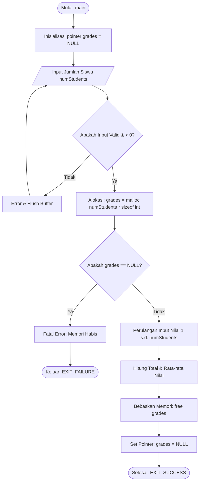

# 📝 TEMPLATE PENGERJAAN TUGAS 2: ANALISIS ALOKASI MEMORI
**Nama Anggota:** [Nama Anggota 5]  
**NIM:** [NIM Anggota 5]  
**Peran:** Security & Memory Auditor (Tugas 2)  

---

## 1. Analisis Kesalahan Manajemen Memori pada Kode Asli (Root Cause Analysis)

Jelaskan minimal 4–5 kelemahan pada potongan kode asli berikut:
```c
#include <stdio.h>
#include <stdlib.h>
int main() {
    int *grades;
    int numStudents, i;
    printf("Enter number of students: ");
    scanf("%d", &numStudents);
    grades = malloc(numStudents * sizeof(int));
    for(i = 0; i < numStudents; i++) {
        printf("Enter grade for student %d: ", i + 1);
        scanf("%d", &grades[i]);
    }
    // Memory leak, no free call
    return 0;
}
```

### Poin Analisis yang Wajib Dibahas:
1. **Critical Memory Leak:** Ketiadaan fungsi `free(grades)`. Jelaskan dampaknya jika program berjalan di server atau sistem akademik yang berulang.
2. **Unchecked Return Value `malloc`:** Ketiadaan validasi `if (grades == NULL)`. Jelaskan risiko terjadinya `SIGSEGV` (*Segmentation Fault*) jika RAM habis.
3. **Ketiadaan Validasi Input `numStudents`:** Dampak jika pengguna menginput angka negatif ($\le 0$) atau angka sangat besar yang memicu *integer overflow* pada `numStudents * sizeof(int)`.
4. **Kerapuhan Input `scanf`:** Penanganan jika pengguna menginput huruf/string bukan angka dan perlunya pembersihan *input buffer*.
5. **Dangling Pointer Risk:** Perlunya menyetel `grades = NULL` setelah pemanggilan `free(grades)`.

---

## 2. Kode Program C Perbaikan
*Tuliskan kode C lengkap yang sudah diperbaiki, bebas dari memory leak, dan dilengkapi validasi input.*
*(Simpan file kodenya di `src/question_2_fix.c` atau masukkan ke dalam blok kode di bawah ini).*

```c
#include <stdio.h>
#include <stdlib.h>

// Tuliskan implementasi kode C perbaikan Anda di sini...

```

---

## 3. Flowchart Proses Alokasi Memori yang Benar
*Gambarkan flowchart alur eksekusi kode yang benar (mulai dari inisialisasi pointer, validasi input, alokasi memori + cek NULL, loop input nilai, agregasi rata-rata, hingga `free` dan selesai).*


