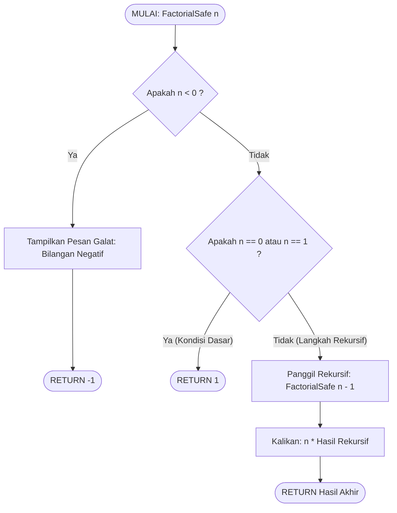

# 🤖 DOKUMENTASI HAICOLA — SOAL 2 DCCA 3 (DEBUGGING & ANALISIS LOGIKA FAKTORIAL REKURSIF)
**Mata Kuliah:** Algorithm and Programming (COMP6112036)  
**Kelas:** DCCA - LEC  
**Kelompok:** Group 1  
**Topik Evaluasi:** Debugging Fungsi Rekursif, Root Cause Analysis (RCA) *Infinite Recursion*, Mekanisme Alokasi Bingkai Tumpukan (*Stack Frame Exhaustion*), Pencegahan *Stack Overflow Exception*, Validasi Bilangan Negatif (*Guard Clause*), dan Pemodelan Diagram Alur (*Flowchart*) ISO.  

---

> 📌 **Catatan untuk Rekan Tim:**  
> Berkas ini berisi dokumentasi sesi **HAICOLA (Human-AI Collaboration)** untuk **Soal 2 (Kalkulator Faktorial Rekursif)**. Dokumen ini dapat kalian jadikan referensi utama dalam memahami cara menganalisis bug memori, menulis pseudocode perbaikan yang kokoh, serta lampiran resmi untuk pengisian formulir `AI_Usage_Declaration_Form_EN.docx`.

---

### 1. ⚠️ Potongan Kode Sebelum Konsultasi AI (Kode Asli Bermasalah dari Soal)

Potongan *pseudo code* asli yang diberikan pada lembar tugas:

```text
Function factorial(n):
    if n == 0:
        return 1
    else:
        return n * factorial(n)   <-- BUG LOGIKA FATAL
```

#### Masalah / Gejala pada Kode Awal:
1. **Kegagalan Progresi Parameter (*No Parameter State Decrement*):**  
   Fungsi memanggil dirinya sendiri pada blok `else` dengan parameter `factorial(n)`, di mana nilai `n` sama sekali tidak pernah dikurangi.
2. **Rekursi Tanpa Henti (*Infinite Recursion Loop*):**  
   Untuk setiap input bilangan bulat positif ($n > 0$, misal $n=5$), fungsi memanggil `factorial(5)`, lalu `factorial(5)`, seterusnya secara tak terbatas. Evaluasi `if n == 0` tidak pernah tercapai.
3. **Ledakan Memori Tumpukan (*Call Stack Overflow Crash*):**  
   Setiap pemanggilan fungsi mengalokasikan satu *stack frame* (menyimpan register CPU, return address, dan variabel lokal). Karena rekursi tidak pernah mencapai titik balik (*unwinding*), alokasi memori stack akan melampaui kuota memori proses dan memicu penghentian paksa (*Segmentation Fault / Stack Overflow Crash*).
4. **Ketiadaan Validasi Bilangan Negatif:**  
   Tidak ada pengecekan jika pengguna memasukkan $n < 0$. Dalam matematika diskret, faktorial hanya terdefinisi untuk bilangan bulat non-negatif ($n \ge 0$).

---

### 2. 💬 Prompt / Pertanyaan yang Diajukan ke AI Assistant

```text
"Halo, kelompok kami sedang mengerjakan evaluasi kalkulator faktorial rekursif untuk sistem edukasi interaktif Museum Sains dan Matematika Indonesia (Tugas 2 TK3 Week 9 - Algorithm and Programming BINUS).

Kami menemukan potongan pseudo code berikut yang menyebabkan aplikasi museum crash seketika saat diuji coba pengunjung:
Function factorial(n):
    if n == 0:
        return 1
    else:
        return n * factorial(n)

Pertanyaan dan bantuan yang kami butuhkan:
1. Bagaimana analisis akar penyebab (Root Cause Analysis - RCA) secara mendalam, terutama pengaruhnya terhadap arsitektur memori Call Stack dan Stack Frame komputer?
2. Bagaimana versi pseudo code perbaikan yang benar, aman dari infinite recursion, serta menangani edge cases seperti 0!, 1!, dan bilangan bulat negatif?
3. Bagaimana gambaran diagram alur (Flowchart) berstandar ISO (menggunakan sintaks Mermaid flowchart TD) yang mencerminkan fungsi rekursif yang benar dan kokoh tersebut?"
```

---

### 3. 🧠 Jawaban dan Evaluasi Teknis dari AI Code Assistant

> **Evaluasi & Solusi Teknis AI:**
> 
> 1. **Dua Syarat Mutlak Rekursi (*The Two Invariants of Recursion*):**  
>    Agar suatu fungsi rekursif bekerja dengan benar, fungsi tersebut wajib memenuhi:
>    - **Kondisi Dasar (*Base Case*):** Nilai evaluasi pasti yang menghentikan pemanggilan diri (dalam kasus faktorial: $0! = 1$ dan $1! = 1$).
>    - **Progresi Monoton Menuju Base Case:** Setiap pemanggilan rekursif harus memodifikasi nilai state sehingga mendekati kondisi dasar (menggunakan `factorial(n - 1)`).
> 
> 2. **Analisis Stack Frame Memori:**  
>    Ketika baris `return n * factorial(n)` dieksekusi, CPU menyimpan alamat instruksi pemanggil ke dalam stack. Karena nilai $n$ tidak pernah berubah menjadi 0, pemanggilan terjadi ribuan hingga jutaan kali per detik hingga batas memori tumpukan (*stack limit*, biasanya 1MB - 8MB tergantung OS) habis terlampaui.
> 
> 3. **Penyempurnaan Penanganan Bilangan Negatif:**  
>    Fungsi wajib menyertakan klausul penjaga (*guard clause*) di awal: jika $n < 0$, sistem harus mengembalikan nilai penanda galat (misal: `-1`) dan tidak boleh melanjutkan eksekusi rekursif.

---

### 4. 🚀 Desain Solusi Final Hasil Validasi AI

#### A. Pseudo Code Versi Perbaikan (Aman & Kokoh)
```text
ALGORITHM FactorialSafe(n)
    INPUT:
        n : Bilangan bulat
    OUTPUT:
        Nilai n! atau -1 jika input tidak valid (bilangan negatif)

BEGIN
    // 1. Guard Clause (Validasi Bilangan Negatif)
    IF n < 0 THEN
        PRINT "Galat: Faktorial hanya terdefinisi untuk bilangan bulat non-negatif!"
        RETURN -1
    ENDIF

    // 2. Base Case (Kondisi Dasar Terminasi: 0! = 1 dan 1! = 1)
    IF n == 0 OR n == 1 THEN
        RETURN 1
    ELSE
        // 3. Recursive Step yang Benar (Parameter Didekremen Menuju Base Case)
        RETURN n * FactorialSafe(n - 1)
    ENDIF
END
```

#### B. Flowchart Rekursif yang Benar (Sintaks Mermaid)


---

### 5. 🎓 Dampak Pembelajaran & Manfaat Kolaborasi Manusia-AI

1. **Pemahaman Arsitektur Memori (*Call Stack*):**  
   Mahasiswa tidak hanya melihat rekursi sebagai konsep matematika abstrak, tetapi memahami secara fisik bagaimana memori komputer mengelola alokasi tumpukan (*stack unwinding*).
2. **Disiplin Rekayasa Perangkat Lunak (*Defensive Programming*):**  
   Mahasiswa belajar bahwa validasi input awal (*guard clause*) untuk kasus bilangan negatif sangat krusial agar sistem tidak mengalami *undefined behavior*.
3. **Standarisasi Diagram Alur:**  
   Penyusunan flowchart berbasis Mermaid mempermudah tim mendokumentasikan logika visual secara presisi langsung di dalam Markdown.
