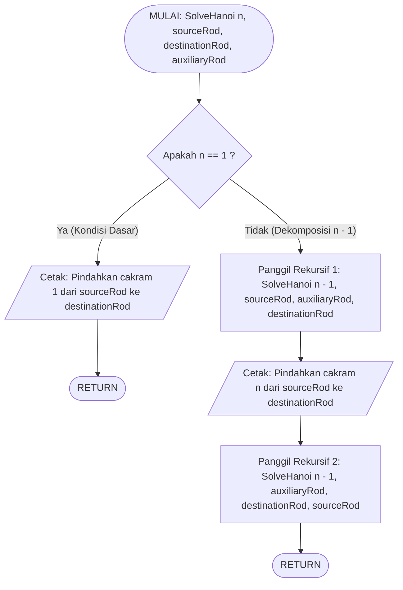

# 📝 LEMBAR KERJA SLOT 2: SOAL 1C & DIAGRAM (TOWERS OF HANOI — TEORI & VISUAL)
**Fokus Soal:** Soal 1 (Towers of Hanoi 4 Cakram)  
**Modul:** Soal 1C (Analisis Kompleksitas Waktu & Ruang) & Diagram Alir (*Flowchart*) Towers of Hanoi  
**Nama Anggota:** Chandra Perdiansyah  
**NIM:** 3002887011  
**Bobot Bagian:** 20% dari total nilai tugas  

---

## 🎯 Instruksi Pengerjaan (Berdasarkan Soal Resmi Binus)
> *"Gambarkan flowchart untuk fungsi rekursif Towers of Hanoi.*  
> *Analisis dan sebutkan kompleksitas waktu algoritma berdasarkan jumlah cakram."*

---

## ✍️ LEMBAR JAWABAN RESMI

### 1. Diagram Alir (Flowchart) Rekursif Towers of Hanoi

Berikut diagram alur rekursif fungsi `SolveHanoi(n, source, dest, aux)` menggunakan standar simbol ISO dan pemodelan alur *Divide and Conquer*:

#### Penjelasan Simbol dan Alur Eksekusi:
1. **Terminator `MULAI` & `RETURN`:** Menandai titik masuk (*entry point*) dan titik keluar (*exit point*) dari frame fungsi rekursif pada tumpukan memori (*call stack*).
2. **Decision `Apakah n == 1 ?`:** Memeriksa kondisi batas (*base case*).
3. **Jalur Cabang `Ya` ($n=1$):** Kondisi tanpa percabangan sub-masalah. Langsung memindahkan cakram terkecil (cakram 1) ke tiang tujuan dan melakukan `RETURN`.
4. **Jalur Cabang `Tidak` ($n > 1$):** Menjalankan 3 langkah *Divide and Conquer*:
   - Memindahkan $(n-1)$ cakram ke tiang perantara (`Aux`).
   - Memindahkan cakram ke-$n$ langsung ke tiang tujuan (`Dest`).
   - Memindahkan kembali $(n-1)$ cakram dari tiang perantara ke tiang tujuan.

---

### 2. Analisis Kompleksitas Waktu Towers of Hanoi (Soal 1C)

#### A. Pembentukan Persamaan Rekurensi
Setiap pemanggilan fungsi `SolveHanoi(n, ...)` untuk $n > 1$ melakukan:
1. **Dua kali** pemanggilan rekursif untuk sub-masalah berukuran $(n - 1)$, yaitu:
   - `SolveHanoi(n - 1, source, aux, dest)`
   - `SolveHanoi(n - 1, aux, dest, source)`
2. **Satu kali** operasi pemindahan fisik cakram terbesar ke-$n$ yang bernilai waktu konstan $\mathcal{O}(1)$.

Dengan demikian, fungsi waktu $T(n)$ dirumuskan sebagai:
$$T(n) = 2T(n - 1) + 1, \quad \text{untuk } n > 1$$
dengan kondisi batas (*base case*):
$$T(1) = 1$$

---

#### B. Penurunan Matematis dengan Metode Substitusi Berulang (*Repeated Substitution*)

Kita melakukan ekspansi persamaan secara bertingkat:

$$\begin{aligned}
T(n) &= 2T(n - 1) + 1 \\
&= 2 \left[ 2T(n - 2) + 1 \right] + 1 \\
&= 2^2 T(n - 2) + 2 + 1 \\
&= 2^2 \left[ 2T(n - 3) + 1 \right] + 2 + 1 \\
&= 2^3 T(n - 3) + 2^2 + 2^1 + 2^0
\end{aligned}$$

Dari pola di atas, setelah $k$ kali substitusi diperoleh bentuk umum:
$$T(n) = 2^k T(n - k) + \sum_{i=0}^{k - 1} 2^i$$

Untuk mencapai kondisi dasar $T(1)$, kita tetapkan:
$$n - k = 1 \iff k = n - 1$$

Substitusikan $k = n - 1$ ke dalam persamaan umum:
$$\begin{aligned}
T(n) &= 2^{n - 1} T(1) + \sum_{i=0}^{n - 2} 2^i
\end{aligned}$$

Karena $T(1) = 1$, dan menggunakan rumus jumlah deret geometri berhingga $\sum_{i=0}^{m} r^i = \frac{r^{m+1} - 1}{r - 1}$ dengan rasio $r = 2$ dan suku akhir $m = n - 2$:
$$\sum_{i=0}^{n - 2} 2^i = \frac{2^{(n - 2) + 1} - 1}{2 - 1} = 2^{n - 1} - 1$$

Maka diperoleh rumus tertutup (*closed-form expression*):
$$\begin{aligned}
T(n) &= 2^{n - 1}(1) + (2^{n - 1} - 1) \\
&= 2 \cdot 2^{n - 1} - 1 \\
\mathbf{T(n)} &\mathbf{= 2^n - 1}
\end{aligned}$$

#### Verifikasi untuk $n = 4$ Cakram:
$$T(4) = 2^4 - 1 = 16 - 1 = \mathbf{15 \text{ langkah}}$$
*Terbukti persis dengan 15 langkah perpindahan pada tabel di Slot 1.*

---

#### C. Kesimpulan Notasi Asimptotik Big-O

1. **Kompleksitas Waktu (*Time Complexity*): $\mathcal{O}(2^n)$ — Eksponensial**
   - **Alasan:** Suku dominan dari persamaan $T(n) = 2^n - 1$ adalah $2^n$. Konstanta pengurang $-1$ diabaikan dalam batas asimptotik atas.
   - **Implikasi Komputasi:** Setiap penambahan $1$ cakram akan **menggandakan ($2\times$)** jumlah operasi perpindahan yang harus dieksekusi. Oleh karena itu, teka-teki Towers of Hanoi dikategorikan sebagai masalah komputasi berlatensi tinggi (*computationally expensive*) untuk nilai $n$ yang besar (misalnya untuk $n = 64$, dibutuhkan $2^{64} - 1 \approx 1.84 \times 10^{19}$ langkah).

2. **Kompleksitas Ruang (*Space Complexity*): $\mathcal{O}(n)$ — Linier**
   - **Alasan:** Ruang memori tambahan tidak ditentukan oleh jumlah total perpindahan ($2^n - 1$), melainkan oleh kedalaman tumpukan memori aktif maksimum (*maximum call stack depth*) pada satu satuan waktu.
   - Karena setiap pemanggilan rekursif hanya menumpuk frame dari $n, n-1, \dots$ hingga mencapai $1$, tinggi maksimum pohon rekursi (*recursion tree height*) adalah tepat sebesar $n$.
   - Ketika pemanggilan rekursif pertama `SolveHanoi(n-1, ...)` selesai, memori frame fungsi tersebut langsung dibebaskan (*popped from stack*) sebelum pemanggilan rekursif kedua dijalankan.
   - Dengan demikian, untuk $n = 4$ cakram, konsumsi memori tumpukan hanya membutuhkan paling banyak $4$ frame bersamaan, sehingga ruang memorinya sangat efisien dan aman dari risiko *Stack Overflow*.

---

## 📚 Referensi Pendukung (Standar Binus)
1. Deitel, P. J., & Deitel, H. M., *C How to Program: With an Introduction to C++* (8th Edition), Pearson Education, diakses pada 25 Oktober 2026.
2. Cormen, T. H., Leiserson, C. E., Rivest, R. L., & Stein, C., *Introduction to Algorithms* (3rd Edition), MIT Press, diakses pada 25 Oktober 2026.
3. BINUS University, *Lecture Notes 06: Function and Recursion - Algorithm and Programming*, Binus Online Learning, diakses pada 25 Oktober 2026.
